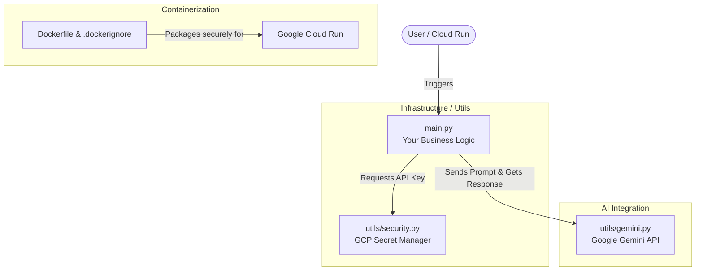

# kiss-cloud-python-architecture

A simple, production-ready, modular boilerplate designed to bootstrap Python applications integrated with Google Cloud Platform (GCP) and the Google Gemini API, following the **KISS** (*Keep It Simple, Stupid*) principle.

Stop wasting time on boilerplate plumbing (security, secrets, Docker, and environment configuration). **Clone this repo, write your business logic in `main.py`, and deploy.**

---

## 🏗️ Architecture Overview

The following diagram illustrates the simple, decoupled architecture of this template:



---

## 🚀 Key Features

- **🔐 Secure by Default:** Built-in integration with Google Cloud Secret Manager. No hardcoded API keys.
- **⚡ Modular Architecture:** Pre-configured `utils/` directory for infrastructure and external services.
- **🤖 Gemini Ready:** Out-of-the-box helpers for Gemini API calls with automatic fallback diagnostics.
- **🐳 Cloud Run Optimized:** Fully containerized with `Dockerfile` and `.dockerignore`, ready for serverless deployments.
- **🤖 AI Assistant Included:** Comes with a local `python-project-assistant` skill to help maintain code standards and documentation.

---

## 📁 Project Structure

```text
.
├── .agents/skills/        # Local AI assistant rules (python-project-assistant)
├── utils/
│   ├── __init__.py        # Package initializer
│   ├── security.py        # GCP Secret Manager connector
│   └── gemini.py          # Gemini API client & safe execution helpers
├── .env                   # Local environment variables (Ignored by Git)
├── .gitignore             # Git exclusion rules
├── .dockerignore          # Docker build exclusion rules (Secures secrets)
├── Dockerfile             # Container definition for Cloud Run
├── requirements.txt       # Core project dependencies
└── main.py                # 👈 YOUR CODE GOES HERE
```

---

## 🛠️ Quickstart Guide

### 1. Clone & Setup Environment
```bash
# Clone or use this template, then navigate into it
cd kiss-cloud-python-architecture

# Create and activate a virtual environment
python -m venv venv
source venv/bin/activate  # On Windows use: venv\Scripts\activate

# Install dependencies
pip install -r requirements.txt
```

### 2. Configure Local Credentials
Create a `.env` file in the root directory:
```env
GCP_PROJECT_ID=your-gcp-project-id
GEMINI_SECRET_NAME=GEMINI_API_KEY
```

Authenticate with Google Cloud (required to fetch secrets locally):
```bash
gcloud auth application-default login
```

### 3. Run Locally
```bash
python main.py
```

---

## 🚢 How to Use This Template (Your Workflow)

1. **Write your logic:** Open `main.py` and replace the example Gemini prompt with your own application logic.
2. **Add utilities:** If you need to connect to BigQuery, Cloud Storage, or databases, add new modules inside the `utils/` folder.
3. **Deploy to Cloud Run:** 
   ```bash
   gcloud run deploy your-service-name \
     --source . \
     --platform managed \
     --region us-central1 \
     --allow-unauthenticated \
     --set-env-vars GCP_PROJECT_ID="your-project-id",GEMINI_SECRET_NAME="GEMINI_API_KEY"
   ```
